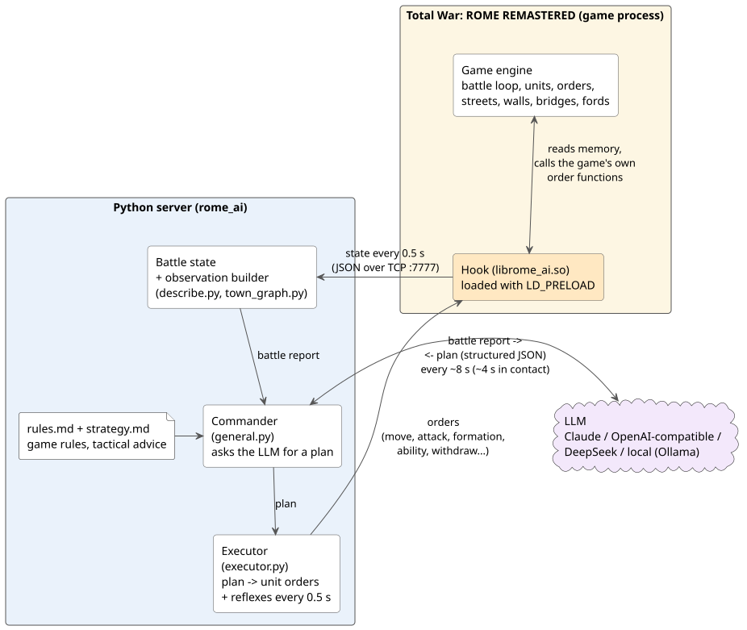
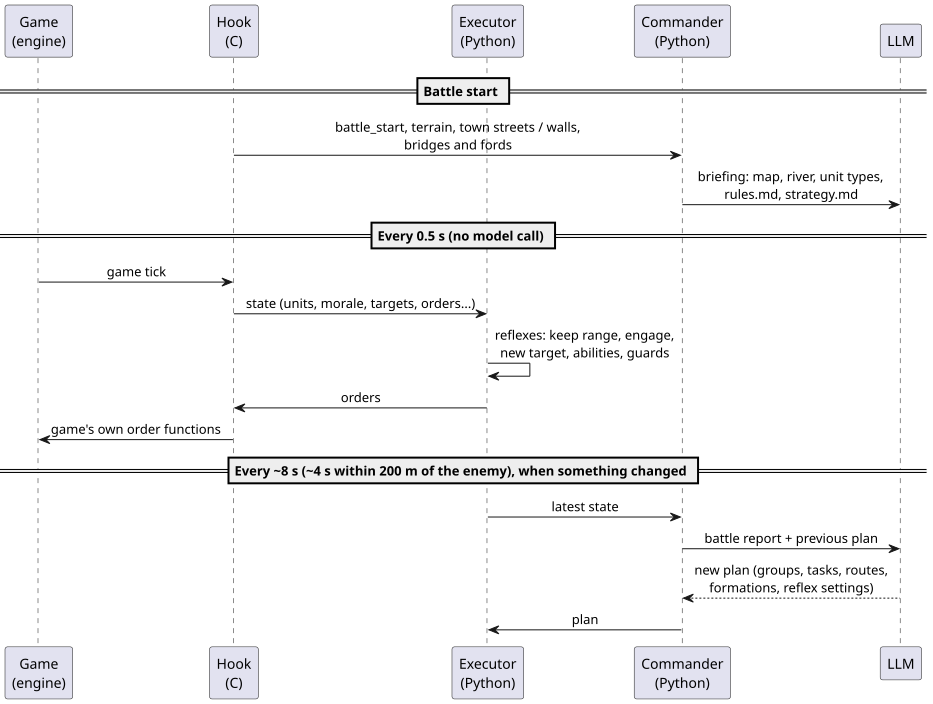
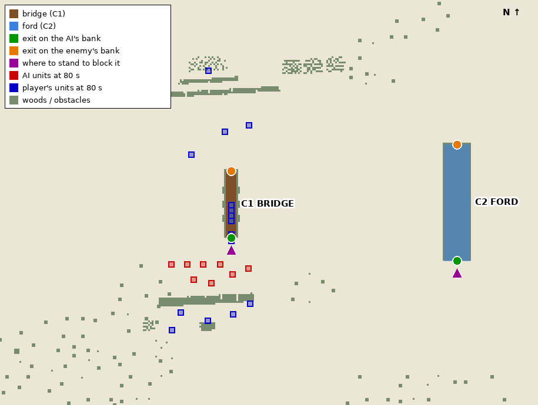
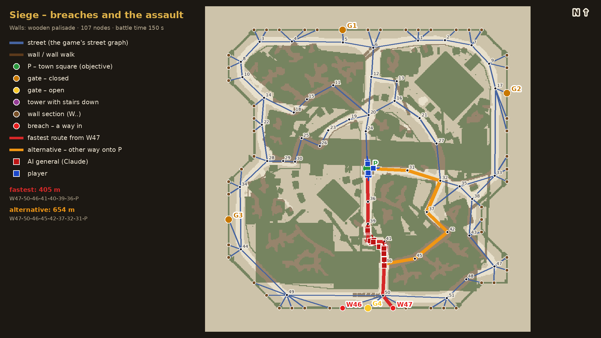
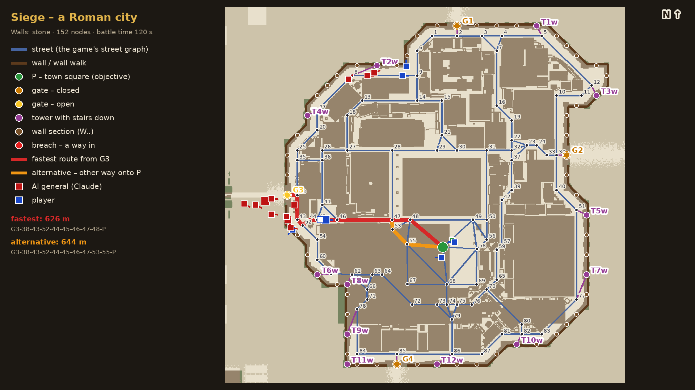
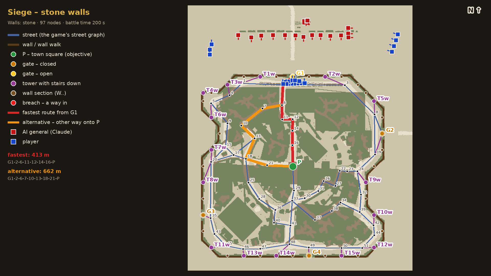

# Rome Battle AI

**English** | [Polski](README.pl.md)

Rome: Total War has always struggled with its battle AI: units idling under the walls, rams left alone at the
gate, generals charging into the front line, armies that never react when you go round their flank. This mod
hands the AI side of a battle to an LLM (Claude by default). The model reads the battle, makes a plan every few
seconds, and the mod carries that plan out through the game's own orders.

> **Unofficial fan project.** Not affiliated with or endorsed by SEGA, Creative Assembly, Feral Interactive or
> Anthropic. *Total War* and *Rome: Total War* are trademarks of SEGA; *Claude* is a trademark of Anthropic.
> No game files are included in this repository.

---

## FAQ: the most common questions from the video comments

From about 380 comment threads under the video, the topics that came up most often (most frequent first):

1. **Other Total War games** (~45 comments): Medieval 2 (also with M2EX), Rome 2 (with DEI), Attila, Shogun 2,
   Napoleon, Empire, Warhammer 3, Three Kingdoms.
   *We will run a poll.*
2. **Cost and local models** (~25): how much a battle costs in tokens / API, who pays, can a free or local model
   be used (Ollama, Qwen, 7-14B on the same GPU).
   *It all depends on the length of the battles. With a $20 Claude subscription and its 5-hour session limit you can
   realistically play about 10-15 battles - that is the real figure, not a cautious one. Long battles and Opus use
   the limit up faster.*
3. **Campaign map and diplomacy** (~18): does the AI also play on the strategic map - economy, alliances, army
   movement.
   *This will be in the poll too.*
4. **General personality and learning** (~15): should traits, command stars and rank (coward, madman, Alexander)
   change the behaviour; should the general learn from mistakes and remember earlier battles ("Nemesis system").
   *Yes. Here I am counting on the community's help in preparing good descriptions for the general's initial
   prompt.*
5. **How it works technically** (~12): what data goes to the model and how often, does the session not bloat,
   how text turns into orders, a mod or a hook into the game files, is it MCP.
   *Everything is described below.*
6. **Reaction speed** (~10): can a thinking model keep up in real time, the delays, ideas such as Haiku or "two
   brains" (a fast one for reactions, a slow one for strategy).
   *It all depends on the model (Sonnet needs 2.5 to 6 s per answer). The executor has its own reflexes, and how
   often the AI is asked changes during the battle. Everything is described below.*
7. **The original Rome and mods** (~12): does it work on the 2004 Rome (with REX) or only on Remastered, on big
   mods (Europa Barbarorum, Imperium Romanum, Platinum).
   *The original (base) version will go into the poll as well.*
8. **When and how to get it** (~10): where is it (someone looked in the Steam Workshop), how to install it, will it
   be open source, can I contribute.
   *This README explains how to set up the Python server; the hook binary can be downloaded directly from GitHub,
   or you can compile the hook yourself.*
9. **AI vs AI, and AI on the player's side** (~7): two models fighting each other, handing your own army (or part
   of it) to the AI, auto-resolving battles.
   *Not tested, and quite possibly it will not work at the moment. It can certainly be added.*
10. **Sceptics and unclear points** (~10): "an LLM is not AI", "only slightly better than the original", "the
    battles were odd or unbalanced", "which side is the AI?", "is the graphics a mod?", "will it slow my PC
    down?", "do I need internet and an API key?".
    *It depends.*

---

## 1. Playing with the mod

### Before you start: what to expect

This is **work in progress**. It changes from day to day, and plenty of things are still rough:

- **Sieges work, but clumsily.** Assaults on walled towns, siege equipment and street fighting are the least
  polished part.
- **Rivers: early support, still needs work.** The general sees every bridge and ford, which bank is his and
  who reaches each crossing first, and has held a bridge exit well in tests. But he does **not know where the
  river itself runs** (only the crossings), so for example he cannot line his troops up along the bank, and only
  a few river battles have been played.
- **Not yet tested:** battles at **forts**. They may work, they may not.
- **Linux only for now.** It needs the native Linux version of the game. A **Windows** version is in progress.
- **One exact game version.** See below. On any other version the mod switches itself off and the game runs
  normally with its own AI.
- The AI is only as good as the model behind it, and each plan takes a few seconds. Sometimes it will make odd
  decisions. That is part of the fun, and battle logs of such moments are very welcome (see *Contributing*).

### Requirements

| | |
|---|---|
| **Game** | *Total War: ROME REMASTERED*, **native Linux version, 2.0.5** (Steam public branch, build 8081527). Other versions are not supported: the hook checks the game binary and disables itself if it does not match. |
| **System** | Linux, Python **3.12+** (`gcc` and `make` only to build the hook from source) |
| **A model** | one of: a **Claude** subscription with [Claude Code](https://claude.com/claude-code) installed (default, the best tested); an **Anthropic API** key; any **OpenAI-compatible** API (OpenAI, OpenRouter, a local model in Ollama / LM Studio...); **DeepSeek**. Only Claude has been tested in real battles so far; the others are experimental. |

### Install

**Step 1 - get the mod.** Pick one:

- **Option A - ready zip (easiest).** On this repository's GitHub page open **Releases** and download the latest
  `rome-battle-ai-*.zip`. It already contains the built hook. Unpack it somewhere in your home folder, e.g.
  `~/rome-battle-ai`.
- **Option B - git clone** (if you use git):

  ```bash
  git clone https://github.com/Cegli865/rome-battle-ai.git ~/rome-battle-ai
  ```

  A clone has no built hook: download `librome_ai.so` from **Releases** into `~/rome-battle-ai/hook/`, or compile
  it yourself (needs `gcc` and `make`): `make -C ~/rome-battle-ai/hook`.

**Step 2 - install the Python part** (once). Open a terminal and run:

```bash
cd ~/rome-battle-ai
python3 -m venv .venv
.venv/bin/pip install -r requirements.txt
```

**Step 3 - tell Steam to load the mod.** In Steam: **ROME REMASTERED → Properties → General → Launch options**,
paste the full path to `launch.sh` followed by `%command%`, e.g.:

```
/home/YOUR_USER_NAME/rome-battle-ai/launch.sh %command%
```

`launch.sh` loads the mod **only when the AI server is running** (see *Play* below). Without it, the game starts
exactly as usual. No game file is ever modified.

### Play

1. Start the AI server **before** the battle, in a terminal (leave it open while you play):

   ```bash
   cd ~/rome-battle-ai
   .venv/bin/python -m rome_ai.server --backend claude-code --effort medium
   ```

   Other models:

   ```bash
   .venv/bin/python -m rome_ai.server --backend claude-code --model claude-opus-5-5   # stronger, slower
   .venv/bin/python -m rome_ai.server --backend claude-code --model claude-haiku-4-5  # NOT recommended: fast but too weak to command, for testing only
   .venv/bin/python -m rome_ai.server --backend claude --model claude-sonnet-5-5      # Anthropic API (ANTHROPIC_API_KEY)
   .venv/bin/python -m rome_ai.server --backend openai --model gpt-5                  # OPENAI_API_KEY
   .venv/bin/python -m rome_ai.server --backend openai --base-url http://localhost:11434/v1 --model qwen3:14b    # Ollama
   ```

   > **Important - using an API directly (`--backend claude` or `--backend openai`) needs an API key.**
   > Set it in the **same terminal, before** starting the server:
   >
   > ```bash
   > export ANTHROPIC_API_KEY=sk-ant-...    # for --backend claude
   > export OPENAI_API_KEY=sk-...           # for --backend openai
   > ```
   >
   > Without the key the model never answers and the computer's army is left to the game's own AI.
   > Not needed for `--backend claude-code` (uses your Claude Code login) or for Ollama.

   For a local model in Ollama, start Ollama with a large context window (the battle report is long), e.g.
   `OLLAMA_CONTEXT_LENGTH=32768 ollama serve`. Small local models give clearly weaker and slower generals.

2. Start the game from Steam. **Sign that everything works:** a few seconds after the game starts (already
   in the main menu) the server console prints

   ```
   INFO hello: rome-remastered v1
   ```

   No such line? The mod is not loaded - check the Steam launch options and that the server was running first.

   Now fight a battle (custom battle or campaign). The **computer's side** is commanded by the model. If the
   server stops or the model stops answering, the army goes back to the game's own AI.

3. Every battle is logged to `logs/battle-*.jsonl`: what the general saw and what it decided. The mod's own log
   (connection, taking control, orders carried out) is usually `~/.local/share/rome-ai/hook.log` - Steam runs the
   game in a container that cannot write into the mod folder (otherwise it is `hook/hook.log`).

4. When you are done, stop the server with **Ctrl+C**. The next time you start the game without the server,
   it runs exactly as usual.

**To uninstall:** remove the text from the Steam launch options and delete the `rome-battle-ai` folder (and
`~/.local/share/rome-ai`). Nothing else on your system or in the game was changed.

You can teach the general your own tactics without touching code, in plain English, one point per line:

- [`strategy.md`](strategy.md) - tactical advice (where to keep the general, how to use artillery, what to do
  at a river...). The general weighs it and may depart from it when the situation calls for something else.
  This is the file to edit for your own tactics.
- [`rules.md`](rules.md) - facts about the game and hard rules (the general's death breaks the army's morale,
  a phalanx cannot run, units cannot pass a closed gate...). The general always plans with them.

Both are re-read before every battle.

---

## 2. How it works



The project is a small **agent harness** around a language model: an observation builder, a plan schema the
model answers with, a loop, and an executor that turns plans into game orders.

### The hook (C, `hook/`)

- Loaded into the game process with `LD_PRELOAD` by `launch.sh`. No file of the game is changed on disk.
- It replaces one pointer in memory: the game's per-tick battle update. From then on the game calls the hook on
  every tick, on the game's own main thread, and the hook calls the original function first.
- Every 0.5 s it reads the battle from memory (units, positions, men, morale, fatigue, ammunition, formations,
  abilities, current orders and targets of **both** sides, walls, gates, the town street network, bridges and
  fords) and sends it as JSON over a local TCP connection (`localhost:7777`) to the Python server.
- It executes the orders it gets back by calling the **game's own order functions** (move, attack, formation,
  special ability, rally, withdraw...), the same way the game's battle scripts do. Before anything else it checks
  the game binary and switches itself off on an unknown version.

The hook takes no tactical decisions. It is only the bridge to the game.

### The commander and the executor (Python, `rome_ai/`)



- **The commander** (`general.py`) is the LLM. About every 8 seconds (every 4 seconds once the armies are within
  200 m of each other), when the battle has changed, it gets a compact battle report (`describe.py`) and answers
  with a **plan** in a fixed JSON schema (`plan.py`): groups of units, each with a task (move, attack, attack a
  building, halt, withdraw), a route, a formation (a line, a column, or any shape it likes, e.g. a square facing
  all sides), and **reflex settings**. The system prompt is in `general.py`, the game rules in
  [`rules.md`](rules.md) and the tactical advice in [`strategy.md`](strategy.md).
- **The executor** (`executor.py`) runs every 0.5 s without calling the model. It turns the plan into unit
  orders (formation slots, waypoints, facing) and runs the **reflexes** the commander switched on:
  - `keep_range_m`: back off from enemies that come too close (missile units, the general);
  - `engage_within_m`: attack any enemy that comes near, then return to position;
  - `on_target_lost`: pick the nearest enemy when the target dies or routs;
  - `attack_from`: go round to the target's flank or rear before charging;
  - `melee`: missile units (horse archers, skirmishers) charge hand to hand instead of shooting - their
    skirmish mode is switched off for the charge and back on afterwards;
  - abilities at the right moment (e.g. a warcry only when the enemy is within 40 m);
  - safety guards (artillery never fires over its own siege equipment, attacks on own or absent units are
    redirected).

### Reflexes save tokens

The model does not micro-manage. It sets the *intent* ("hold this line, attack anything within 50 m, keep the
archers 60 m from the enemy") and the executor reacts locally, twice a second, for free. The model is only asked
again when something actually changes: losses, a unit routing, a large move, or enemies within 200 m. One model
session lasts the whole battle, so the long briefing is sent once.

### From coordinates to graphs: field battles vs. sieges

In a **field battle** the general works with metres: unit positions, distances, directions, a coarse terrain
map, and orders like "move to (120, -300), facing south, in a line". When a **river** crosses the field, it
gets every bridge and ford as two points, the exit on its own bank and the exit on the enemy's bank, plus a
point where a unit can block it, and in every report who will reach each exit first and who is on the crossing
now. It does not get the course of the river itself, only that it cannot be crossed anywhere else.



*A river battle 80 s in: the AI holds a line just behind the bridge exit on its bank, and the player's infantry
comes off the bridge in a column straight onto it, while the player's cavalry has crossed at the ford.*

In a **settlement** that breaks down: units can only move along streets, and walls, gates and towers decide
where you can get in. So in sieges the general gets the town as a **graph**, built from the game's own street
network: street nodes, the square **P** (the objective), gates **G**, wall sections **W**, towers **T** with
stairs, breaches as they open. Routes are paths of node ids. For every gate and every open breach it gets the
fastest route to the square and an alternative one that enters the square by another street, and it can ask
for more routes (e.g. around a street an enemy phalanx is blocking).

| A palisade town, two breaches open | A Roman city, the AI entering at G3 |
|---|---|
|  |  |



*Red / blue squares: the AI's and the player's units at that moment. Red line: the fastest route to the square,
orange: the alternative.*

Siege equipment (rams, ladders, siege towers) and, in sieges, the artillery are left to the game's own scripts,
which know how to use them. The general takes those units over once their job is done.

---

## 3. Contributing

Everyone is welcome:

- **Pull requests** are welcome: fixes, new reflexes, better battle reports, support for more models, the
  Windows port.
- **Ideas and bugs:** open an **issue**. For a strange decision in battle, attach the battle log from `logs/`
  (it records what the general saw and what it decided) and, if you can, the moment in the battle.
- **Better tactics:** improvements to [`strategy.md`](strategy.md) (and fixes to [`rules.md`](rules.md)) are
  contributions too.
- **Please never commit files from the game itself.**

## License

[MIT](LICENSE)
