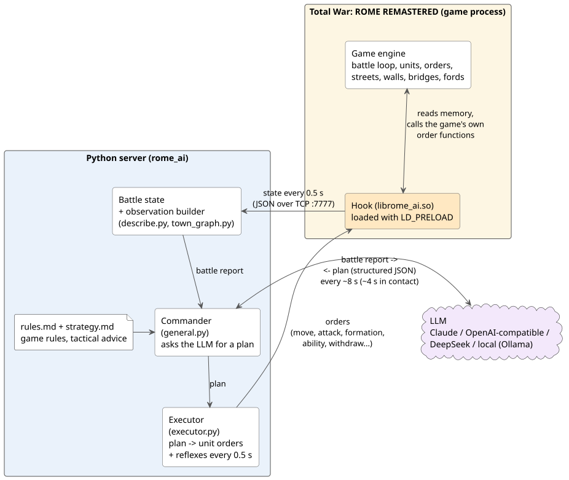
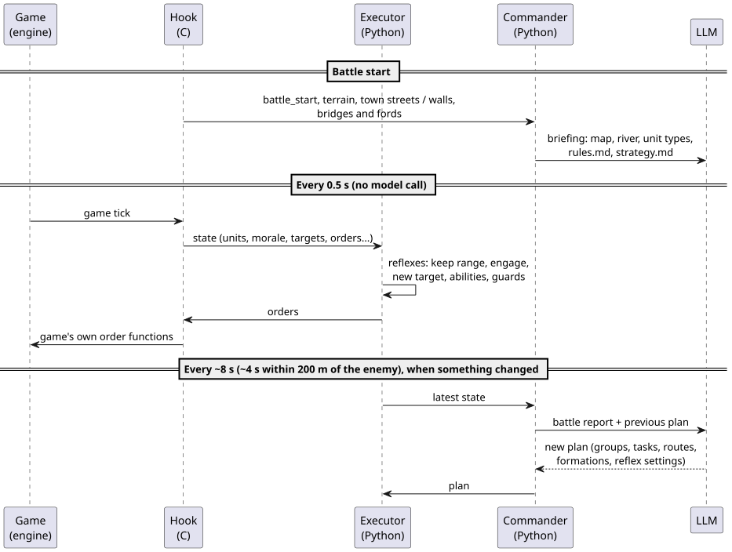
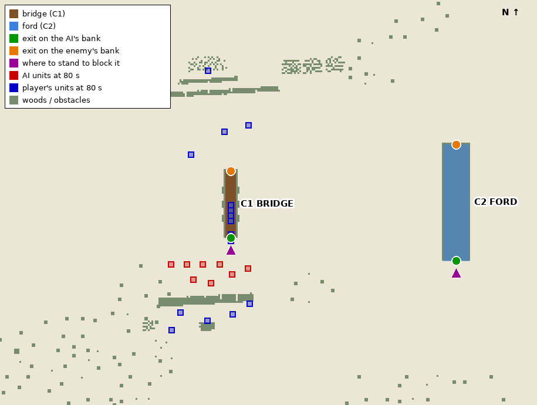
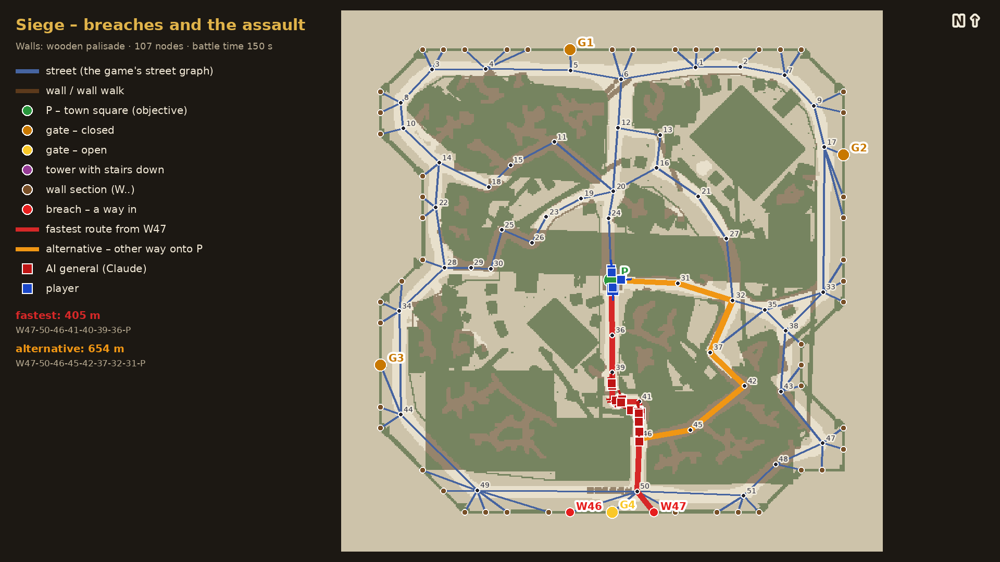
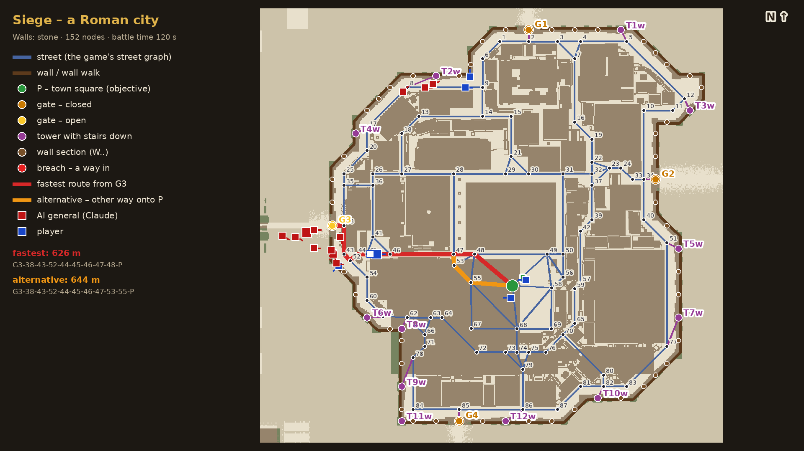
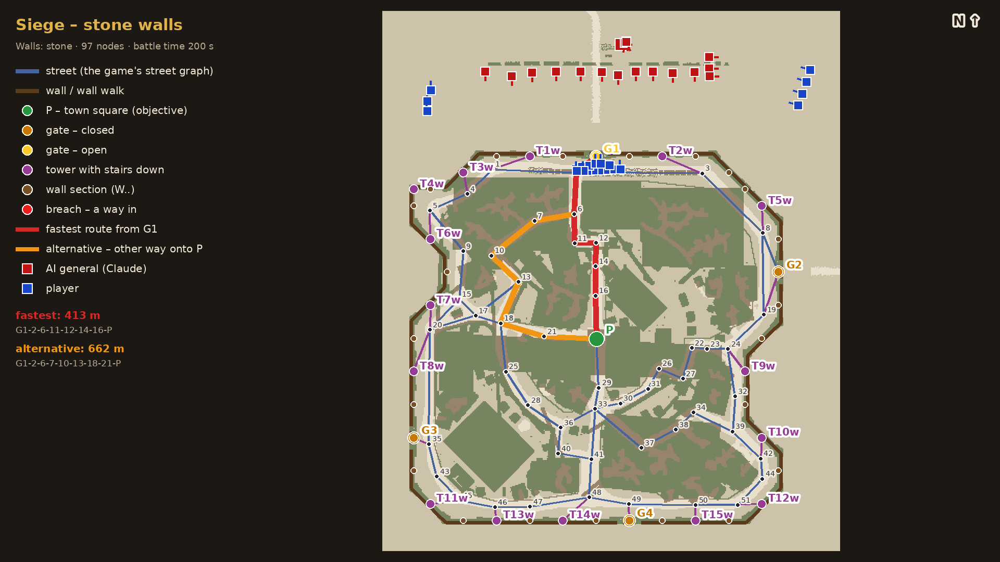

# Rome Battle AI

[English](README.md) | **Polski**

Rome: Total War od zawsze miało problem z AI w bitwach: oddziały stoją bezczynnie pod murami, taran zostaje
sam pod bramą, generał szarżuje w pierwszej linii, a armia nie reaguje, gdy obchodzi się ją skrzydłem. Ten mod
oddaje stronę komputera modelowi językowemu (domyślnie Claude). Model czyta przebieg bitwy, co kilka sekund
układa plan, a mod wykonuje go własnymi rozkazami gry.

> **Nieoficjalny projekt fanowski.** Niezwiązany z SEGA, Creative Assembly, Feral Interactive ani Anthropic.
> *Total War* i *Rome: Total War* to znaki towarowe SEGA; *Claude* to znak towarowy Anthropic.
> Repozytorium nie zawiera żadnych plików gry.

---

## FAQ: najczęstsze pytania z komentarzy pod filmem

Z około 380 wątków komentarzy pod filmem najczęściej wracały te tematy (od najczęstszego):

1. **Inne gry Total War** (~45 komentarzy): Medieval 2 (także z M2EX), Rome 2 (z DEI), Attila, Shogun 2,
   Napoleon, Empire, Warhammer 3, Three Kingdoms.
   *Zrobimy ankietę.*
2. **Koszt i modele lokalne** (~25): ile kosztuje bitwa w tokenach / API, kto płaci, czy da się użyć darmowego
   lub lokalnego modelu (Ollama, Qwen, 7-14B na tej samej karcie).
   *Wszystko zależy od długości bitew. Przy subskrypcji Claude za 20 $ z 5-godzinnym limitem sesji realnie da się
   rozegrać około 10-15 bitew - to faktyczna liczba, a nie ostrożne założenie. Długie bitwy i Opus zużywają limit
   szybciej.*
3. **Mapa kampanii i dyplomacja** (~18): czy AI gra też na mapie strategicznej - gospodarka, sojusze, ruchy armii.
   *To też będzie w ankiecie.*
4. **Osobowość generała i nauka** (~15): czy cechy, gwiazdki dowodzenia i ranga (tchórz, szaleniec, Aleksander)
   mają zmieniać zachowanie; czy generał ma się uczyć na błędach i pamiętać poprzednie bitwy („system Nemesis”).
   *Tak. Tu liczę oczywiście na wsparcie społeczności w przygotowaniu odpowiednich opisów do inicjalnego promptu
   dla generała.*
5. **Jak to działa technicznie** (~12): jakie dane trafiają do modelu i jak często, czy sesja nie puchnie, jak
   tekst zamienia się w rozkazy, mod czy wpięcie w pliki gry, czy to MCP.
   *Wszystko jest opisane poniżej.*
6. **Szybkość reakcji** (~10): czy model z myśleniem nadąża w czasie rzeczywistym, opóźnienia, pomysły z Haiku
   albo „dwoma mózgami” (szybki do reakcji, wolny do strategii).
   *Wszystko zależy od modelu (Sonnet potrzebuje od 2,5 do 6 s na odpowiedź). Wykonawca ma swoje odruchy, a
   częstotliwość pytań do AI też się zmienia w trakcie bitwy. Wszystko jest opisane poniżej.*
7. **Oryginalne Rome i mody** (~12): czy działa na Rome z 2004 roku (z REX), czy tylko na Remastered, czy na dużych
   modach (Europa Barbarorum, Imperium Romanum, Platinum).
   *Podstawowa wersja też trafi do ankiety.*
8. **Kiedy i jak pobrać** (~10): gdzie to jest (ktoś szukał w Warsztacie Steama), jak zainstalować, czy będzie open
   source, czy można współtworzyć.
   *W tym README jest opis, jak postawić serwer w Pythonie; plik binarny hooka będzie do pobrania bezpośrednio
   z GitHuba. Można też samemu skompilować hooka.*
9. **AI kontra AI i AI po stronie gracza** (~7): bitwy dwóch modeli, przekazanie AI własnej armii (albo jej części),
   automatyczne rozgrywanie bitew.
   *To nie było testowane i bardzo możliwe, że na ten moment nie będzie działać. Na pewno można to dodać.*
10. **Sceptycy i niejasności** (~10): „LLM to nie AI”, „tylko trochę lepsze niż oryginał”, „bitwy były dziwne albo
    niewyrównane”, „która strona to AI?”, „czy grafika to mod?”, „czy obciąży komputer?”, „czy trzeba internetu
    i klucza API?”.
    *Zależy.*

---

## 1. Granie z modem

### Zanim zaczniesz: czego się spodziewać

To **wersja w budowie**. Zmienia się z dnia na dzień i sporo rzeczy jest jeszcze niedopracowanych:

- **Oblężenia działają, ale koślawo.** Szturmy na miasta z murami, sprzęt oblężniczy i walki w ulicach to
  najmniej dopracowana część.
- **Rzeki: wstępne wsparcie, wymaga jeszcze dopracowania.** Generał widzi każdy most i bród, wie, który brzeg
  jest jego i kto pierwszy dojdzie do każdej przeprawy, a w testach dobrze bronił wyjścia z mostu. **Nie wie
  jednak, którędy płynie sama rzeka** (zna tylko przeprawy), więc np. nie ustawi wojsk wzdłuż brzegu. Rozegrano
  też dopiero kilka bitew nad rzeką.
- **Jeszcze nieprzetestowane:** bitwy przy **fortach**. Mogą działać, ale nie muszą.
- **Na razie tylko Linux.** Potrzebna jest natywna linuksowa wersja gry. Wersja na **Windowsa** jest w przygotowaniu.
- **Jedna konkretna wersja gry.** Szczegóły niżej. Na każdej innej wersji mod sam się wyłącza, a gra działa
  normalnie, ze swoim AI.
- AI jest tak dobre, jak model, którego używa, a każdy plan zajmuje kilka sekund. Czasem podejmie dziwne
  decyzje. To część zabawy, a logi z takich bitew bardzo się przydają (patrz *Współtworzenie*).
- **Nie kupuj tokenów API ani subskrypcji Claude Code specjalnie pod ten mod.** Na tym etapie najpewniej się
  rozczarujesz.

### Wymagania

| | |
|---|---|
| **Gra** | *Total War: ROME REMASTERED*, **natywna wersja linuksowa, 2.0.5** (publiczna gałąź Steama, kompilacja 8081527). Inne wersje nie są obsługiwane: hook sprawdza plik gry i wyłącza się, jeśli się nie zgadza. |
| **System** | Linux, Python **3.12+** (`gcc` i `make` tylko do kompilacji hooka ze źródeł) |
| **Model** | jeden z: subskrypcja **Claude** z zainstalowanym [Claude Code](https://claude.com/claude-code) (domyślnie, najlepiej sprawdzony); klucz **API Anthropic**; dowolne API **zgodne z OpenAI** (OpenAI, OpenRouter, model lokalny w Ollama / LM Studio...); **DeepSeek**. W prawdziwych bitwach sprawdzony jest na razie tylko Claude, reszta jest eksperymentalna. |

### Instalacja

**Krok 1 - pobierz moda.** Wybierz jedną z opcji:

- **Opcja A - gotowy plik zip (najprościej).** Na stronie repozytorium na GitHubie otwórz **Releases** i pobierz
  najnowszy `rome-battle-ai-*.zip`. Jest w nim już zbudowany hook. Rozpakuj go gdzieś w katalogu domowym, np. do
  `~/rome-battle-ai`.
- **Opcja B - git clone** (jeśli używasz gita):

  ```bash
  git clone https://github.com/Cegli865/rome-battle-ai.git ~/rome-battle-ai
  ```

  W klonie nie ma zbudowanego hooka: pobierz `librome_ai.so` z **Releases** do `~/rome-battle-ai/hook/` albo
  skompiluj go sam (potrzebne `gcc` i `make`): `make -C ~/rome-battle-ai/hook`.

**Krok 2 - zainstaluj część w Pythonie** (jednorazowo). Otwórz terminal i wpisz:

```bash
cd ~/rome-battle-ai
python3 -m venv .venv
.venv/bin/pip install -r requirements.txt
```

**Krok 3 - powiedz Steamowi, żeby ładował moda.** W Steamie: **ROME REMASTERED → Właściwości → Ogólne → Opcje
uruchamiania**, wklej pełną ścieżkę do `launch.sh`, a po niej `%command%`, np.:

```
/home/TWOJA_NAZWA_UŻYTKOWNIKA/rome-battle-ai/launch.sh %command%
```

`launch.sh` ładuje moda **tylko wtedy, gdy działa serwer AI** (patrz *Gra* niżej). Bez niego gra startuje zupełnie
normalnie. Żaden plik gry nie jest zmieniany.

### Gra

1. Uruchom serwer AI **przed** bitwą, w terminalu (zostaw go otwartego na czas gry):

   ```bash
   cd ~/rome-battle-ai
   .venv/bin/python -m rome_ai.server --backend claude-code --effort medium
   ```

   Inne modele:

   ```bash
   .venv/bin/python -m rome_ai.server --backend claude-code --model claude-opus-5-5   # mocniejszy, wolniejszy
   .venv/bin/python -m rome_ai.server --backend claude-code --model claude-haiku-4-5  # NIEZALECANY: szybki, ale za słaby do dowodzenia, tylko do testów
   .venv/bin/python -m rome_ai.server --backend claude --model claude-sonnet-5-5      # API Anthropic (ANTHROPIC_API_KEY)
   .venv/bin/python -m rome_ai.server --backend openai --model gpt-5                  # OPENAI_API_KEY
   .venv/bin/python -m rome_ai.server --backend openai --base-url http://localhost:11434/v1 --model qwen3:14b    # Ollama
   ```

   > **Ważne - korzystanie bezpośrednio z API (`--backend claude` albo `--backend openai`) wymaga klucza API.**
   > Ustaw go w **tym samym terminalu, przed** uruchomieniem serwera:
   >
   > ```bash
   > export ANTHROPIC_API_KEY=sk-ant-...    # dla --backend claude
   > export OPENAI_API_KEY=sk-...           # dla --backend openai
   > ```
   >
   > Bez klucza model nie odpowiada, a armią komputera dowodzi wbudowane AI gry.
   > Niepotrzebne przy `--backend claude-code` (używa zalogowanego Claude Code) ani przy Ollamie.

   Dla modelu lokalnego w Ollamie uruchom Ollamę z dużym oknem kontekstu (raport z bitwy jest długi), np.
   `OLLAMA_CONTEXT_LENGTH=32768 ollama serve`. Małe modele lokalne dają wyraźnie słabszych i wolniejszych generałów.

2. Uruchom grę ze Steama. **Znak, że wszystko działa:** kilka sekund po starcie gry (już w menu głównym)
   w konsoli serwera pojawia się

   ```
   INFO hello: rome-remastered v1
   ```

   Brak tej linii? Mod się nie załadował - sprawdź opcje uruchamiania w Steamie i czy serwer był włączony wcześniej.

   Teraz stocz bitwę (własną albo w kampanii). **Stroną komputera** dowodzi model. Jeśli serwer się zatrzyma
   albo model przestanie odpowiadać, armia wraca do wbudowanego AI gry.

3. Każda bitwa jest zapisywana w `logs/battle-*.jsonl`: co generał widział i co postanowił. Własny log moda
   (połączenie, przejęcie armii, wykonane rozkazy) to zwykle `~/.local/share/rome-ai/hook.log` - Steam uruchamia
   grę w kontenerze, który nie może zapisywać do folderu moda (inaczej log jest w `hook/hook.log`).

4. Po grze zatrzymaj serwer klawiszami **Ctrl+C**. Gdy następnym razem uruchomisz grę bez serwera, działa ona
   dokładnie jak zwykle.

**Odinstalowanie:** usuń wpis z opcji uruchamiania w Steamie i skasuj folder `rome-battle-ai` (oraz
`~/.local/share/rome-ai`). Nic innego w systemie ani w grze nie było zmieniane.

Możesz uczyć generała własnej taktyki bez ruszania kodu, zwykłym angielskim, jeden punkt w linijce:

- [`strategy.md`](strategy.md) - rady taktyczne (gdzie trzymać generała, jak używać artylerii, co robić nad
  rzeką...). Generał bierze je pod uwagę i może od nich odstąpić, gdy sytuacja wymaga czegoś innego. To ten
  plik edytujesz, żeby nauczyć go własnej taktyki.
- [`rules.md`](rules.md) - fakty o grze i twarde zasady (śmierć generała łamie morale armii, falanga nie może
  biec, przez zamkniętą bramę nie da się przejść...). Generał zawsze planuje z ich uwzględnieniem.

Oba pliki są wczytywane przed każdą bitwą.

---

## 2. Jak to działa



Projekt to niewielki **harness agenta** wokół modelu językowego: budowanie obrazu bitwy, schemat planu, którym
model odpowiada, pętla i wykonawca, który zamienia plany na rozkazy w grze.

### Hook (C, `hook/`)

- Ładowany do procesu gry przez `LD_PRELOAD` w `launch.sh`. Żaden plik gry na dysku nie jest zmieniany.
- Podmienia w pamięci jeden wskaźnik: funkcję aktualizacji bitwy wywoływaną w każdym kroku gry. Od tej chwili
  gra w każdym kroku woła hook, w swoim głównym wątku, a hook najpierw wywołuje oryginalną funkcję.
- Co 0,5 s czyta bitwę z pamięci gry (oddziały, pozycje, ludzie, morale, zmęczenie, amunicja, formacje,
  umiejętności, bieżące rozkazy i cele **obu** stron, mury, bramy, sieć ulic miasta, mosty i brody) i wysyła
  ją jako JSON przez lokalne połączenie TCP (`localhost:7777`) do serwera w Pythonie.
- Otrzymane rozkazy wykonuje, wywołując **własne funkcje rozkazów gry** (ruch, atak, formacja, umiejętność
  specjalna, rally, odwrót...), tak samo jak robią to skrypty bitew. Najpierw sprawdza plik gry i przy nieznanej
  wersji się wyłącza.

Hook nie podejmuje decyzji taktycznych. Jest tylko mostem do gry.

### Dowódca i wykonawca (Python, `rome_ai/`)



- **Dowódca** (`general.py`) to model językowy. Mniej więcej co 8 sekund (co 4 sekundy, gdy armie są bliżej niż
  200 m), gdy coś się w bitwie zmieni, dostaje zwięzły raport (`describe.py`) i odpowiada **planem** w ustalonym
  formacie JSON (`plan.py`): grupy oddziałów, każda z zadaniem (ruch, atak, atak na budynek, stój, odwrót), trasą,
  formacją (linia, kolumna albo dowolny kształt, np. czworobok z frontem na wszystkie strony) i **ustawieniami
  odruchów**. Instrukcja systemowa jest w `general.py`, zasady gry w [`rules.md`](rules.md), a rady taktyczne w
  [`strategy.md`](strategy.md).
- **Wykonawca** (`executor.py`) działa co 0,5 s bez pytania modelu. Zamienia plan na rozkazy dla oddziałów
  (miejsca w szyku, punkty trasy, kierunek frontu) i uruchamia **odruchy**, które włączył dowódca:
  - `keep_range_m`: odskok od wroga, który podejdzie za blisko (strzelcy, generał);
  - `engage_within_m`: atak na każdego wroga, który podejdzie, potem powrót na miejsce;
  - `on_target_lost`: atak na najbliższego wroga, gdy cel zginie albo ucieknie;
  - `attack_from`: obejście celu z boku albo od tyłu przed szarżą;
  - `melee`: oddziały strzelające (konni łucznicy, harcownicy) szarżują wręcz zamiast strzelać - na czas
    szarży wykonawca wyłącza im tryb harcowania, a potem włącza go z powrotem;
  - umiejętności we właściwym momencie (np. okrzyk bojowy dopiero, gdy wróg jest 40 m od oddziału);
  - zabezpieczenia (artyleria nigdy nie strzela nad własnym sprzętem oblężniczym, a ataki na własne albo
    nieobecne oddziały są przekierowywane).

### Odruchy oszczędzają tokeny

Model nie zarządza każdym ruchem. Ustala *zamiar* („trzymaj tę linię, atakuj wszystko w promieniu 50 m, trzymaj
łuczników 60 m od wroga”), a wykonawca reaguje na miejscu, dwa razy na sekundę, za darmo. Model jest pytany
ponownie dopiero wtedy, gdy coś się naprawdę zmieni: straty, ucieczka oddziału, duży ruch albo wróg bliżej niż
200 m. Jedna sesja modelu trwa całą bitwę, więc długi opis pola bitwy jest wysyłany tylko raz.

### Od współrzędnych do grafów: bitwy polowe a oblężenia

W **bitwie polowej** generał posługuje się metrami: pozycje oddziałów, odległości, kierunki, uproszczona mapa
terenu, a rozkazy wyglądają np. tak: „idź do (120, -300), frontem na południe, w linii”. Gdy przez pole bitwy
płynie **rzeka**, generał dostaje każdy most i bród jako dwa punkty: wyjście na swoim brzegu i wyjście na brzegu
wroga, a do tego miejsce, w którym można przeprawę zablokować. W każdym raporcie widzi, kto pierwszy dojdzie do
każdego wyjścia i kto jest teraz na przeprawie. Nie dostaje przebiegu samej rzeki, tylko informację, że poza
przeprawami nie da się jej przejść.



*Bitwa nad rzeką po 80 s: AI trzyma linię tuż za wyjściem z mostu na swoim brzegu, a piechota gracza schodzi
z mostu kolumną wprost na nią; konnica gracza przeszła przez bród.*

W **mieście** to przestaje działać: oddziały mogą chodzić tylko ulicami, a mury, bramy i wieże decydują o tym,
gdzie da się wejść. Dlatego w oblężeniach generał dostaje miasto jako **graf**, zbudowany z sieci ulic samej gry:
węzły ulic, plac **P** (cel bitwy), bramy **G**, odcinki murów **W**, wieże **T** z zejściami i wyrwy, w miarę
jak powstają. Trasy to ciągi węzłów. Dla każdej bramy i każdej otwartej wyrwy generał dostaje najszybszą trasę
na plac i alternatywną, która wchodzi na plac inną ulicą. Może też poprosić o kolejne trasy, np. omijające
ulicę zablokowaną przez wrogą falangę.

| Miasto z palisadą, dwie wyrwy otwarte | Miasto rzymskie, AI wchodzi przez G3 |
|---|---|
|  |  |



*Czerwone i niebieskie kwadraty: oddziały AI i gracza w danym momencie. Czerwona linia: najszybsza trasa na plac,
pomarańczowa: alternatywna.*

Sprzęt oblężniczy (tarany, drabiny, wieże oblężnicze), a w oblężeniach także artyleria, zostaje przy skryptach
gry, które potrafią go użyć. Generał przejmuje te oddziały, gdy wykonają swoje zadanie.

---

## 3. Współtworzenie

To ma być **projekt społeczności**: jedna osoba nie ma czasu, żeby sama pociągnąć go dużo dalej. Jest bardzo
dużo do poprawy. Harness wciąż nie działa tak, jak powinien - cały czas coś się psuje i całkiem możliwe, że
trzeba go będzie przepisać od nowa - a reguły i strategię na pewno da się napisać lepiej. Małymi krokami wszystko
da się dopracować.

**Pracuj nad nim z agentem AI** (Claude Code, Codex czy co tam używasz). Tak powstał cały projekt: odpal
swojego agenta na repozytorium i logach z bitew i niech on się w tym grzebie. Nikt nie będzie ręcznie przeglądał
kodu.

Każdy może dołożyć swoją cegiełkę:

- **Pull requesty** są mile widziane: poprawki, nowe odruchy, lepsze raporty z bitwy, obsługa kolejnych modeli,
  port na Windowsa.
- **Pomysły i błędy:** załóż **issue**. Przy dziwnej decyzji w bitwie dołącz log bitwy z `logs/` (zapisuje,
  co generał widział i co postanowił) i, jeśli możesz, moment w bitwie.
- **Lepsza taktyka:** poprawki [`strategy.md`](strategy.md) (i [`rules.md`](rules.md)) to też wkład w projekt.
- **Nigdy nie wrzucaj plików samej gry.**

## Licencja

[MIT](LICENSE)
